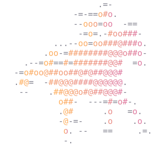

<div align="center">



# jockey

**one saddle, many coding agents**

A terminal app that rides the official coding-agent CLIs (Codex, Claude Code, Grok)
and makes them work together: one agent works while others check, judge and steer it.

</div>

---

## Why

Each coding agent is good on its own. jockey gives you one interface to all of them, and four ways to combine them:

| Mode | What happens |
|---|---|
| **single** | One agent, one conversation. Type while it works to steer it live. |
| **cascade** | A primary attempt, then your checks, then a judge in a read-only snapshot. If it's not accepted, it retries with the feedback: on a fallback agent if you set one, else on the primary. |
| **critique** | A draft, then several critics review one read-only snapshot in parallel. Their findings are merged, and the primary revises. |
| **autosteer** | Critics watch the agent *while it works* and send corrections into the running turn, under a policy you choose. |

Everything runs on the CLIs you already use and are signed in to. jockey never sees your credentials and never uses API keys.

## Quick start

You need at least one of `codex`, `claude` or `grok` installed and signed in.

**Homebrew**:

```sh
brew install lorenzopi/jockey/jockey
```

**macOS** without Homebrew (installs the Xcode command line tools and Rust if they're missing):

```sh
curl -fsSL https://raw.githubusercontent.com/lorenzopi/jockey/main/install.sh | sh
```

**Anywhere**, with Rust 1.85+:

```sh
cargo install --locked --git https://github.com/lorenzopi/jockey
```

From a clone, `./install.sh` or `cargo install --locked --path .` does the same.

```sh
jockey doctor              # finds the CLIs and checks config and quota (no model usage)
jockey                     # opens the TUI in the current folder
jockey --agent mock        # try the UI with a built-in fake agent, no quota spent
```

With no default model configured, jockey asks you to pick **lab › model › thinking** on start. Models and thinking levels come live from each CLI.

## The TUI

- The conversation scrolls, the prompt stays at the bottom, and the footer shows folder, mode, model, permissions, tokens, context fill and subscription limits.
- While an agent works, a jockey gallops along a track. Its pace follows the live token rate, critics ride a second lane, and a finished turn crosses the line with its time and tokens.
- Multi-agent modes split the screen: the primary on one side, a supervisor feed of reviews, findings and steering on the other.
- Every conversation is saved as a run you can reopen and continue.

| Key | Action |
|---|---|
| Enter | send; **while the agent works, steer it** |
| Alt+Enter | queue a follow-up for after the current turn |
| Esc | interrupt the agent (file changes stay) |
| Shift+Enter, Ctrl+J | newline |
| `/` | commands: `/mode` `/model` `/effort` `/profile` `/new` `/history` `/resume` `/review` `/help`, plus provider-native ones |
| `!cmd` | run a shell command and add its output to your next prompt (`!!` to keep it out) |
| Ctrl+L · Shift+Tab | lab › model › thinking picker · cycle thinking level |
| Ctrl+O · Ctrl+T · Ctrl+R | tool output and diffs · reasoning summaries · raw provider events |
| Ctrl+S | autosteer suggestions from critics; Enter sends one to the running agent |
| Ctrl+\\ · Ctrl+Z | stack or split the panes · zoom one |
| Ctrl+X · Ctrl+G | copy the last answer · edit the prompt in `$EDITOR` |
| Ctrl+C · Ctrl+D | interrupt or clear (twice quits) · quit |

When the agent asks for approval: **y** allow, **a** allow for the session, **n** deny. Set `JOCKEY_ASCII=1` if your font lacks emoji.

## Command line

```sh
jockey run --agent codex "add a --verbose flag to the CLI"
jockey run --agent claude:sonnet@high "fix the failing test"
jockey run --mode cascade --agent claude:haiku --fallback codex "implement the parser"
jockey run --mode autosteer --agent codex --critics claude:sonnet,grok "implement the pricing engine"
echo "explain src/main.rs" | jockey run --profile read-only
jockey run --format json "..." | jq .     # JSONL events, then one result line
jockey providers --models                 # versions, steering support, models and efforts
jockey history · jockey show last · jockey resume last "now add tests"
```

Agent text goes to stdout and activity to stderr, so `jockey run ... > answer.md` captures just the answer. Exit codes: `0` completed, `1` failed, `130` interrupted. Ctrl+C stops the agent and everything it started, but **does not undo file changes**.

## Safety

**No surprise bills.** jockey refuses to start, or stops, a run that would bill past your subscription: Codex credits after the 5-hour window, Claude extra usage, Grok pay-as-you-go. Opt in with `--allow-credits` or `providers.<id>.allow_credits = true`.

**Reviewers can't write.** Judges and critics always run read-only, in a copy-on-write snapshot of the workspace.

**Critics can't widen permissions.** Every finding passes a steering controller that rejects unsafe advice (bypass flags, `sudo`, piping to `sh`, API keys), stale or duplicate findings, and correction loops.

| `--profile` | The primary agent may | Notes |
|---|---|---|
| `read-only` | read | always used for judges and critics |
| `workspace-write` (default) | edit inside the working folder | anything else asks; headless, it's denied unless allowed in config |
| `auto` | edit inside the working folder | the provider's own reviewer approves routine actions |
| `full` | anything | requires `--dangerously-allow-all` every time |

## Configuration

`~/.jockey/config.toml`, overlaid by a project's `.jockey.toml`. A repository's file cannot change executable paths, billing or approval rules.

```toml
[defaults]
agent = "codex:gpt-6.1-sol@medium"   # optional; without it jockey asks at startup
profile = "workspace-write"

[autosteer]
count = 1                             # critics, on the primary's model unless `critics` is set
policy = "balanced"                   # observe | suggest | balanced | aggressive

[approvals]
allow_commands = ["cargo test", "cargo check"]
```

Runs are saved under `~/.jockey/runs/` (mode 0700, credentials masked). `jockey config` shows the effective settings and where each came from.

## Docs

- [Workflows](docs/workflows.md): single, cascade and critique in detail
- [Autosteer](docs/autosteer.md): checkpoints, the steering controller, policies, a worked example
- [Architecture](docs/architecture.md): event bus, adapters, sessions, snapshots
- [Providers](docs/providers.md): what each CLI supports, and how it was verified ([research notes](docs/research/))

## Develop

```sh
cargo fmt && cargo clippy --all-targets && cargo test
```

The tests use no network and no provider usage: each adapter is tested against recorded protocol traces and in-memory fakes.

## License

[MIT](LICENSE)
